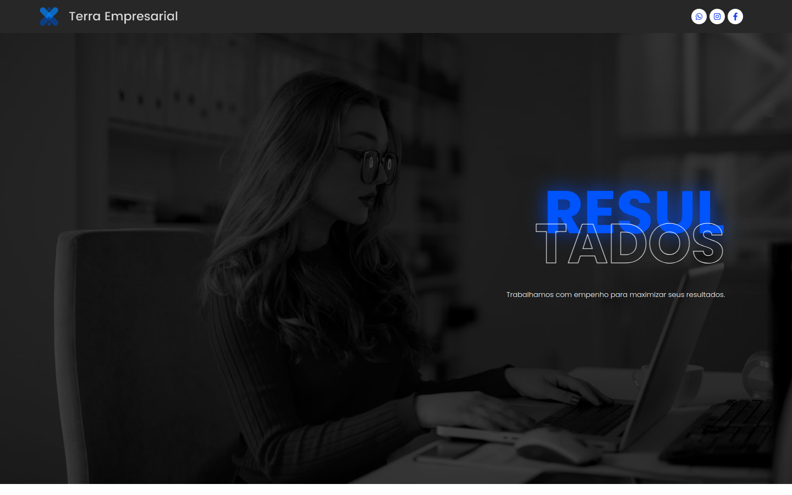
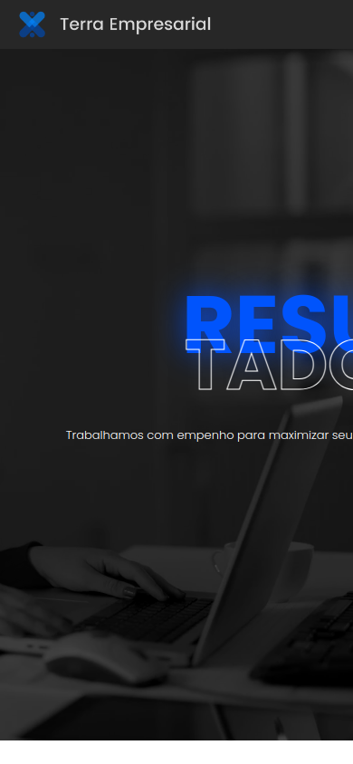

# Auditoria do site: Terra Empresarial

**URL:** https://terraempresarial.com.br/  
**Data:** 2026-11-09  
**Escopo:** página inicial e suas seções públicas (`Início`, `Sobre`, `Cases`, `Serviços` e `Contato`); screenshots desktop 1440 × 900 e mobile 390 × 844; HTML, cabeçalhos HTTP, sitemap, robots.txt e endpoint público REST.  
**Ferramentas:** captura visual remota via thum.io, `curl` e leitura de HTML/REST. A auditoria Playwright não pôde ser executada: o host de browser estava indisponível e o Chrome não foi autorizado nesta sessão. O PageSpeed Insights respondeu com cota diária zerada (HTTP 429).  
**Limitações:** sem console ou rede observados no navegador, navegação por teclado/foco, zoom/reflow, movimento reduzido, contraste calculado, envio de formulário ou métricas Lighthouse/CrUX. Nenhuma conclusão sobre ranking ou conformidade WCAG é inferida. Registro de evidências: [inspeção técnica](auditoria-evidencias-2026-11-09/inspecao-tecnica.md).

## Resumo executivo

A página apresenta os serviços contábeis, valores de planos e duas formas de contato (WhatsApp e formulário). O título e a frase principal do hero ficam cortados na captura mobile de 390 × 844, prejudicando a leitura da proposta logo na entrada. Na estrutura HTML, a página não possui `h1` ou landmarks principais, e vários rótulos de seção estão repartidos em títulos `h2` adjacentes. A primeira tela também não oferece navegação entre seções ou uma chamada principal para contato.

O HTML identifica WordPress, tema Astra e construtor Elementor. Há título de documento, idioma `pt-BR`, sitemap e `robots.txt`. Não foi encontrada meta description. A medição de PageSpeed não foi obtida por limite de cota da API; os números de Lighthouse e Web Vitals ficam sem valor, em vez de estimados.

## Tecnologias identificadas

| Categoria | Tecnologia e versão, se comprovada | Evidência e URL | Confiança e limitações |
|---|---|---|---|
| CMS | WordPress; asset de core declara `6.4.14` | HTML da [homepage](https://terraempresarial.com.br/) referencia `wp-includes`; cabeçalho `Link` aponta para [`/wp-json/`](https://terraempresarial.com.br/wp-json/) e página REST; [`wp-sitemap.xml`](https://terraempresarial.com.br/wp-sitemap.xml) | Confirmado por sinais independentes. A versão é o valor de query string declarado pelo asset servido, não uma verificação administrativa da instalação. |
| Tema | Astra `4.6.1` | CSS e JS em `/wp-content/themes/astra/` com `?ver=4.6.1` na homepage | Confirmado como asset servido; query string não prova configuração interna nem atualização. |
| Construtor | Elementor `3.18.3`; Elementor Pro `3.14.1` | Assets em `/wp-content/plugins/elementor/` e `/elementor-pro/`, com essas versões declaradas | Confirmado como assets servidos; não é um framework frontend separado. |
| Framework frontend | Não identificado | HTML e assets consultados na homepage | Não há evidência suficiente para afirmar React, Vue ou outro framework. |
| Hospedagem / runtime | Cabeçalhos anunciam Hostinger/HCDN e PHP `8.1.34` | Cabeçalhos HTTP da homepage: `platform`, `server` e `x-powered-by` | Provável; cabeçalhos podem refletir proxy ou configuração intermediária. |

## Performance

| Dispositivo | Lighthouse | LCP | TBT | CLS | Tipo de dado |
|---|---:|---:|---:|---:|---|
| Mobile | Não disponível | Não disponível | Não disponível | Não disponível | PSI API: HTTP 429, cota diária zerada |
| Desktop | Não disponível | Não disponível | Não disponível | Não disponível | PSI API: HTTP 429, cota diária zerada |

**CrUX / field data:** não determinado; o PSI não retornou relatório. Não há dados de campo nesta auditoria.  
**Leitura HTTP auxiliar:** uma requisição do documento HTML retornou 171.578 bytes, TTFB de 0,294 s e duração total de 0,439 s no ambiente da auditoria. Esse único fetch não executa os recursos da página no navegador e não representa LCP, experiência de visitantes ou resultado repetível.  
**Oportunidades Lighthouse:** não disponíveis, sem recomendações de performance inferidas.

## Achados prioritários

### Medium — Conteúdo do hero é cortado em viewport mobile

- **Evidência:** screenshot da homepage em 390 × 844: `Resultados` e a frase “Trabalhamos com empenho para maximizar seus resultados.” passam da borda direita e não podem ser lidos por completo. Veja [home-mobile.png](auditoria-evidencias-2026-11-09/home-mobile.png).
- **Impacto:** a proposta principal fica parcialmente ilegível na primeira tela de celular.
- **Recomendação:** ajustar escala tipográfica e largura do bloco para o viewport, permitir quebra de linha e revisar o recorte em 390 px e larguras próximas.

### Medium — Hierarquia semântica e orientação de página incompletas

- **Evidência:** no HTML da homepage não há `<h1>`, `<header>`, `<nav>`, `<main>` ou `<footer>`. Os títulos de seção usam `h2`, e rótulos como “Resultados”, “Estratégias”, “Serviços” e “Contato” são separados em widgets/títulos consecutivos (por exemplo, `Resul` / `tados`).
- **Impacto:** tecnologias assistivas recebem uma hierarquia sem título principal e menos pontos de navegação estrutural; a segmentação pode interromper a leitura dos títulos.
- **Recomendação:** compor cada rótulo como um único título semântico, usar um `h1` para a proposta principal, `h2` para seções e landmarks semânticos para cabeçalho, navegação, conteúdo principal e rodapé.

### Medium — A primeira tela não oferece caminho claro para planos ou contato

- **Evidência:** na captura desktop de 1440 × 900, o cabeçalho mostra marca e ícones sociais, sem menu ou chamada para contato; o hero não contém botão. O HTML apresenta cinco seções com IDs, mas nenhum link de âncora interna. Veja [home-desktop.png](auditoria-evidencias-2026-11-09/home-desktop.png) e os links registrados na [inspeção técnica](auditoria-evidencias-2026-11-09/inspecao-tecnica.md).
- **Impacto:** visitantes precisam percorrer a página para chegar aos planos, serviços ou formulário, apesar de o contato ser a ação comercial principal.
- **Recomendação:** adicionar uma chamada primária para planos/WhatsApp no hero e links de navegação acessíveis para as seções relevantes.

### Medium — Campo de telefone usa tipo numérico

- **Evidência:** campo obrigatório “Telefone” no formulário tem `type="number"`; o HTML associa os rótulos Nome, E-mail, Telefone e Mensagem aos respectivos controles.
- **Impacto:** um telefone é identificado como quantidade numérica, dificultando formatos com `+`, espaços ou pontuação e podendo exibir controles de incremento.
- **Recomendação:** usar `type="tel"` e, se necessário, `inputmode="tel"`, preservando a entrada formatada.

### Medium — Formulário não apresenta link de privacidade junto à coleta

- **Evidência:** a página pede nome, e-mail, telefone e mensagem; não foi encontrado link de política ou aviso de privacidade entre os links públicos da homepage.
- **Impacto:** antes de compartilhar dados de contato, a pessoa não encontra na página uma explicação sobre o uso dessas informações.
- **Recomendação:** incluir próximo ao formulário um aviso curto e um link para a política de privacidade. Esta observação é de transparência e UX, não uma avaliação jurídica.

### Low — Meta description ausente

- **Evidência:** há `<title>` e `lang="pt-BR"`, mas não foi encontrada meta description no HTML da homepage.
- **Impacto:** o site deixa de fornecer uma descrição própria para mecanismos de busca usarem como resumo; não se infere efeito em ranking.
- **Recomendação:** adicionar uma descrição concisa e específica dos serviços e da região atendida.

### Low — Ano do rodapé aparenta estar desatualizado

- **Evidência:** o HTML contém “Terra Empresarial - 2024”, embora esta auditoria seja de 2026.
- **Impacto:** a data pode passar impressão de conteúdo sem revisão recente.
- **Recomendação:** atualizar o ano ou gerá-lo dinamicamente, se corresponder a um aviso de copyright.

### Low — Links de redes sociais usam HTTP

- **Evidência:** os hrefs observados para Instagram e Facebook começam com `http://`; o link de WhatsApp já usa HTTPS.
- **Impacto:** cria uma etapa de redirecionamento ao abrir as redes sociais.
- **Recomendação:** atualizar os dois endereços para HTTPS.

## Pontos fortes

- O propósito do site e a marca aparecem imediatamente no desktop, com identidade visual consistente e contraste visual forte entre o azul, o texto claro e o fundo escuro observado na captura.
- A página informa preços de planos contábeis e certificados digitais, reduzindo a necessidade de contato apenas para descobrir valores.
- WhatsApp e formulário oferecem caminhos diferentes de contato. Os campos do formulário têm rótulos explícitos e são obrigatórios.
- `lang="pt-BR"`, título de documento, viewport móvel, sitemap e `robots.txt` estão presentes.
- As 14 imagens analisadas têm atributo `alt`; duas usam texto alternativo vazio, adequado quando as imagens são decorativas ou redundantes com o texto próximo.

## Evidências visuais

### Desktop — 1440 × 900

### Mobile — 390 × 844

Consulte o [registro de evidências e limitações](auditoria-evidencias-2026-11-09/inspecao-tecnica.md) para condições da captura, sinais técnicos, conteúdo inspecionado e erros de cota do PSI.
